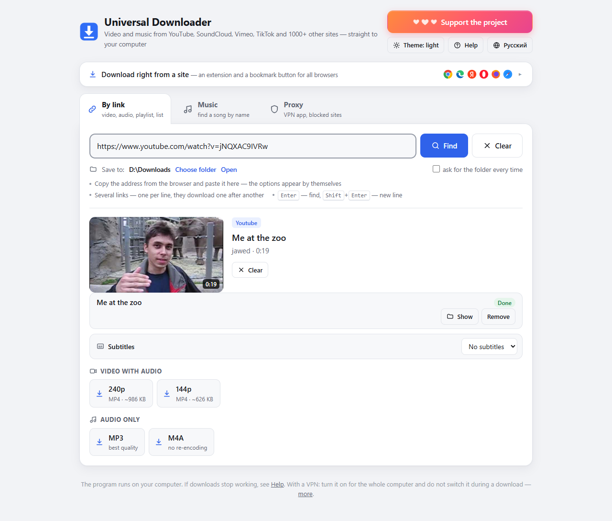
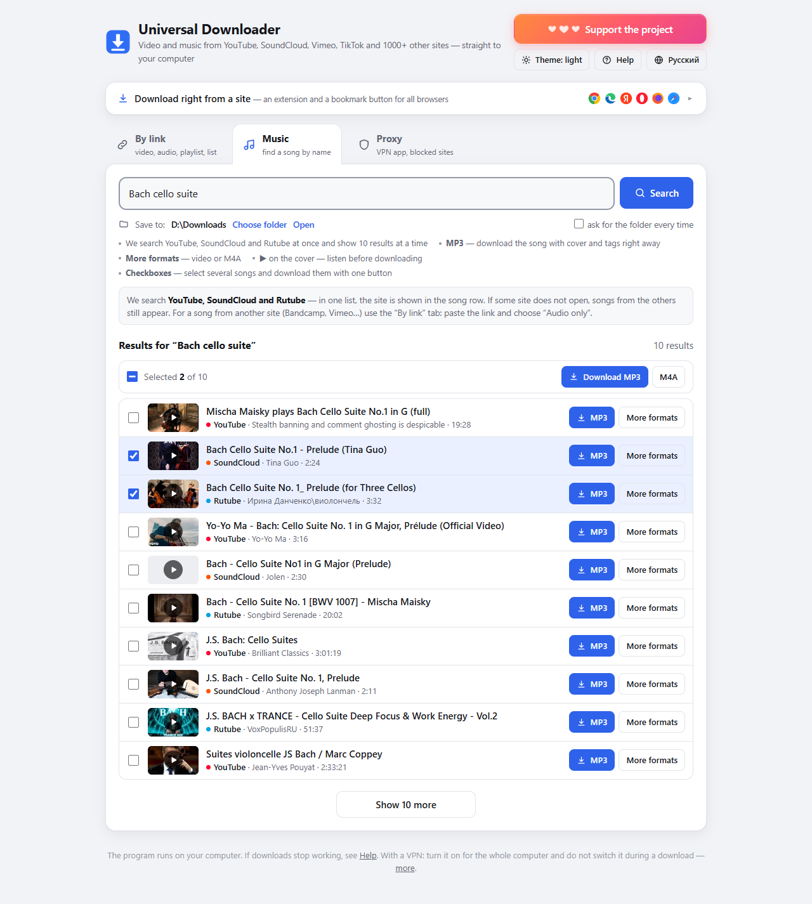
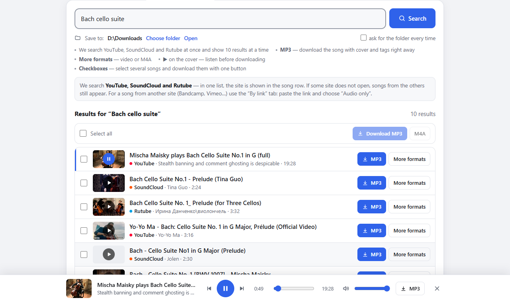
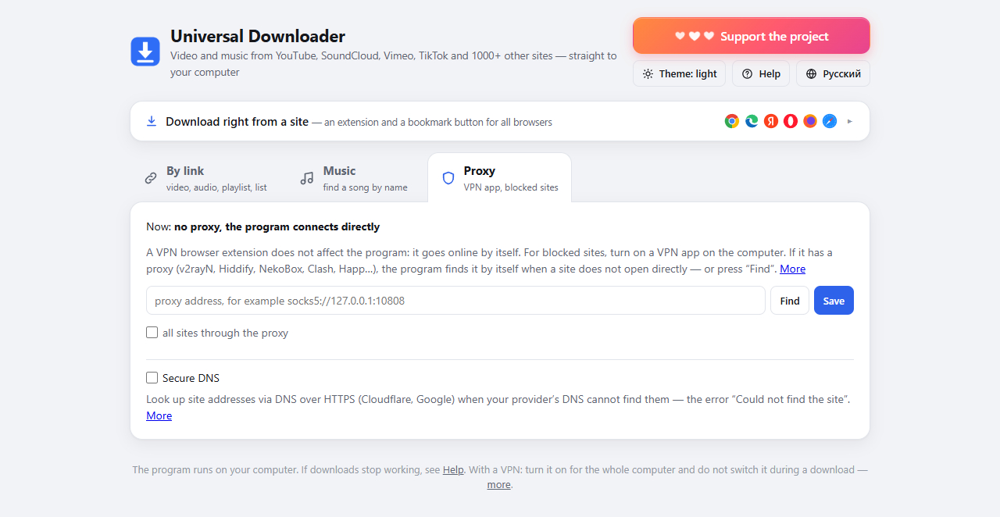
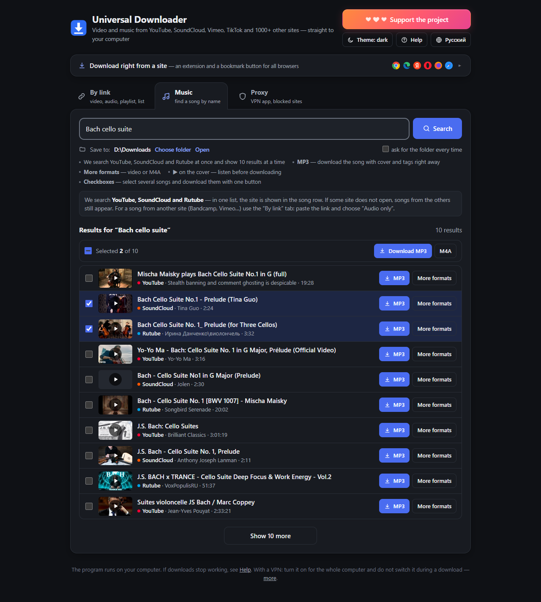
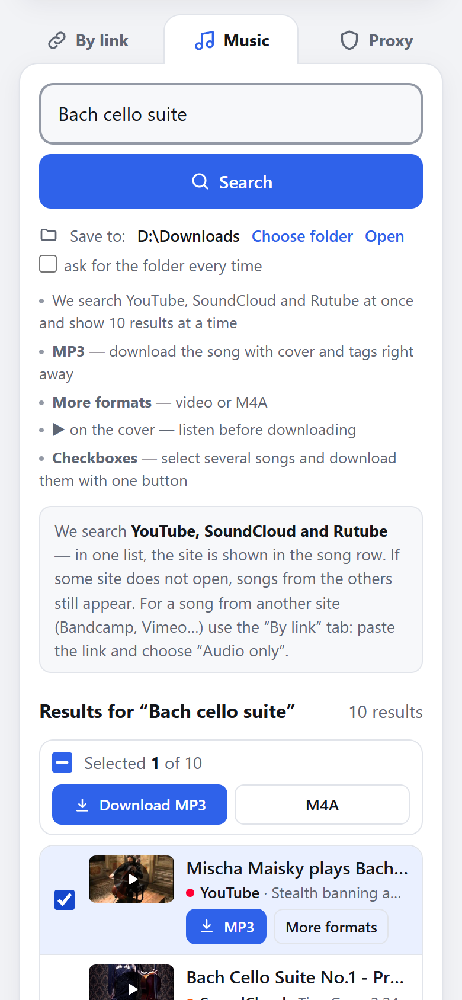
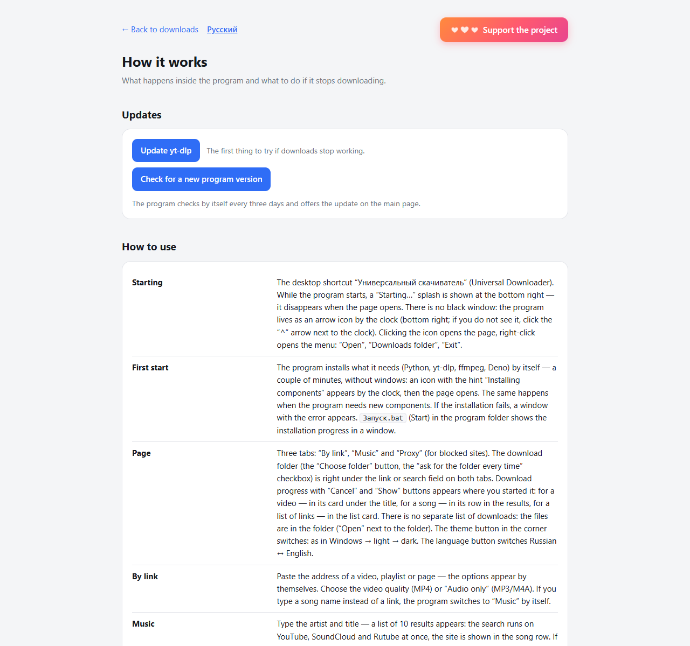

<p align="center">
  <a href="https://dalink.to/olegche"></a>
</p>

# Universal Downloader

[Русский](README.md) · **English**

[](../../releases/latest)
[](../../releases)
[](#installation)
[](https://github.com/yt-dlp/yt-dlp)
[](#features)
[](../../commits/main)
[](../../stargazers)

A Windows program that downloads video and music from YouTube, SoundCloud, Vimeo, TikTok, Instagram, VK, Rutube and 1000+ other sites.
Paste a link or a song name, choose the quality and get an MP4, MP3 or M4A file on your computer.

Everything runs on your computer: no ads, no sign-up, no third-party servers. You do not need to install Python — the program sets up everything it needs by itself.

The interface is in English and Russian: the language button is at the top right of the page (by default — the language of Windows).



**[⬇ Download the latest version (zip)](https://github.com/OlegChe77/universal-downloader/releases/latest/download/universal-downloader.zip)** (`universal-downloader.zip`, direct file) · [release page with the changes](../../releases/latest)

---

## Features

- **Video by link**: MP4 in the quality you choose, from 144p to 4K. Video and audio are merged automatically.
- **Audio only**: MP3 with cover and tags (“Artist – Song” is taken from the video title) or M4A without re-encoding.
- **Music search by name** on YouTube, SoundCloud and Rutube at once — one list of 10 songs with covers and a “Show 10 more” button. MP3 downloads in one click, and with checkboxes you can select several songs and download them with one button.
- **Listen before downloading**: a player at the bottom of the page with seeking, volume and the next song. It works with the keyboard and media keys.
- **Audio tracks and subtitles**: for videos in several languages — choose the track (the original by default) or all of them in one MP4; subtitles — embedded in the video or as a separate `.srt`.
- **Compress video**: a button on a downloaded video makes the file smaller (H.265), the original stays.
- **Playlists and lists of links**: a whole playlist or several links (one per line) download one after another.
- **Sites yt-dlp does not handle by itself**: TikTok and Instagram without signing in, COUB (the video loops for the length of the song), embedded players on other sites (KVS and others), plus a number of Russian sites (Odnoklassniki, YapFiles, COMDI, DTF/vc.ru, d3.ru, online cinema players).
- **Download right from a site**: an extension for Chrome, Edge, Yandex Browser, Opera and Firefox, or a bookmark button (bookmarklet) for any browser. Open a video, click the button, and the program picks up the link. If the program is not running, the extension button starts it.
- **VPN app with a proxy** (v2rayN, Hiddify, NekoBox, Clash, Happ…): if a site does not open directly, the program finds the proxy by itself and goes through it. The “Secure DNS” checkbox helps when your provider “does not know” a site’s address.
- **Icon by the clock**: the program runs in the background without extra windows. Icon menu: “Open”, “Downloads folder”, “Exit”. Starting it again does not pile up tabs: if the page is already open, its title blinks.
- **Your own download folder**, light and dark theme, clear explanations of errors.
- **Updates yt-dlp by itself** once a day: sites often change their protection, and a fresh yt-dlp fixes that.
- **Updates itself too**: every three days it checks GitHub for a new version and installs it with one click (with a SHA-256 check; if the new version does not start, it rolls back).

| Music: search by name, checkboxes and “Download MP3 / M4A” | Listen before downloading |
|---|---|
|  |  |

| The “Proxy” tab: for blocked sites | Dark theme |
|---|---|
|  |  |

| On a narrow screen |
|---|
|  |

---

## Installation

**Requirements:** Windows 10 or 11 (64-bit), internet on the first start and about 350 MB of disk space.

1. Download **[universal-downloader.zip](https://github.com/OlegChe77/universal-downloader/releases/latest/download/universal-downloader.zip)** (always the latest version; what’s new — on the **[Releases](../../releases/latest)** page).
2. Unpack the archive into any folder, for example “Documents”. Do not run the program straight from the archive.
3. Open the folder and double-click **`Запуск.bat`** (“Start”; the file names are in Russian).
4. An installation window opens. The program downloads into its own folder:
   - **Python 3.12** from python.org: the embeddable version, nothing is installed into the system;
   - **yt-dlp**: it knows how to download from sites;
   - **ffmpeg**: merges video with audio and makes MP3;
   - **Deno**: without it YouTube does not give all qualities.

   This takes a couple of minutes.
5. When everything is ready, the window closes by itself. A **“Universal Downloader”** shortcut appears on the desktop, an icon appears by the clock, and the program page opens in the browser.

After that, start the program with the shortcut: it starts right away, without a window — a “Starting…” splash briefly appears at the bottom right while the page opens.

> If Windows asks “Do you want to run this file?”, click “Run”. This happens with files from the internet.
> If an antivirus blocks `ffmpeg.exe` or the installation script, add the program folder to its exclusions.

### Installation safety

`start.ps1` checks everything it downloads:
- the SHA-256 of the Python archive and of pip is compared with values built into the script (checked against python.org and PyPI);
- the digital signature of the **Python Software Foundation** is checked on `python.exe` and `python312.dll`.

If anything does not match, the file is not used. Python is assembled in a temporary `python.new` folder and renamed only when complete, so there is never a half-finished installation.

---

## How to use

### By link
1. Copy the video address from the browser and paste it on the **“By link”** tab. The options appear by themselves.
2. Choose the video quality or **MP3 / M4A**. The download progress is shown right in the video card.
3. Open the finished file with the **“Show”** button.

Several links download one after another: paste them one per line (new line — <kbd>Shift</kbd>+<kbd>Enter</kbd>).
A playlist link offers to download the whole playlist.

### Music
On the **“Music”** tab type an artist or song title. The search runs on YouTube, SoundCloud and Rutube at once — one list, the site is shown in the song row; if some site does not open, songs from the others still appear. Download songs from other sites by link (the “Audio only” option). What you can do with the results:
- **MP3**: download the song with cover and tags right away;
- **More formats**: video or M4A;
- **▶ on the cover**: listen before downloading;
- **checkboxes**: select several songs and download them with one button (MP3 or M4A, one at a time).

Player keys: <kbd>Space</kbd> — pause, <kbd>←</kbd> / <kbd>→</kbd> — seek.

### Download right from a site
Expand the **“Download right from a site”** panel at the top of the page. There are two ways:
- **Extension** for Chrome, Edge, Yandex Browser, Opera and Firefox. Adds a button to the browser toolbar and the “Send to Downloader” item to the right-click menu.
  - Chromium browsers: download the extension archive from the page, unpack it, open `chrome://extensions` (in Opera — `opera://extensions`), turn on “Developer mode”, then “Load unpacked”.
  - Firefox: `about:debugging` → “This Firefox” → “Load Temporary Add-on”. Regular Firefox keeps it only until a restart.
- **Bookmark button (bookmarklet)** works in any browser, including Safari. Drag it to the bookmarks bar and click it on a page with a video.

Detailed instructions with pictures are on the **“Help”** page in the program itself.

### Sites that require signing in
If a site says you need to sign in (private videos, 18+, “confirm you’re not a bot”), put a **`cookies.txt`** file into the program folder.
You can export it from a browser where you are signed in to the site: in Chrome or Edge with the **Get cookies.txt LOCALLY** extension, in Firefox — **cookies.txt**. The “Help” page explains it in detail.
Never share `cookies.txt`: it contains your sign-ins to sites.

---

## If something does not download

- The program has a **“Help”** page that explains common errors. Every error has a **“Details”** button with the original text.
- **Update yt-dlp**: the button on the “Help” page or running `Запуск.bat`. The program also updates it once a day by itself.
- **VPN**: turn it on for the whole computer and do not switch it during a download: video links are tied to your address, and switching the VPN causes error 403. A VPN browser extension does not affect the program. If your VPN app has a proxy, you can find or enter it on the “Proxy” tab.
- The icon does not appear: run `Запуск.bat`, it shows in a window what is wrong. Errors of the program itself are written to `program.log`.
- For a clean reinstall, close the program (icon → “Exit”), delete the `python` and `bin` folders and run `Запуск.bat`.
- **Uninstall** — `Удалить.bat` (“Uninstall”) in the program folder: it closes the program, removes the shortcut and the folder, and offers to delete the downloads inside the folder or move them to the desktop.



Some sites (for example, Suno) are deliberately not supported by yt-dlp for legal reasons. The program tells you so. DRM-protected services (Netflix, Spotify and the like) cannot be downloaded.

---

## How it works

The program is a small **Flask** web server that listens only on `127.0.0.1:8765`. The interface is a regular page in your browser.
Downloading is done by **[yt-dlp](https://github.com/yt-dlp/yt-dlp)**, **ffmpeg** (from the `imageio-ffmpeg` package) merges video with audio, **Deno** solves YouTube’s JavaScript challenges. The icon by the clock is drawn by **pystray**.

The server accepts requests only from its own page. It checks `Host`, `Origin` and `Sec-Fetch-Site` and accepts only JSON in POST requests, so other sites cannot control it.
For sites the built-in yt-dlp extractors cannot handle, `sites.py` has its own.

### Files

| File / folder | What it is |
|---|---|
| `Запуск.bat` | Start with a window: installs and updates components, creates the shortcut, starts the program |
| `start.ps1` | All the installation logic (embeddable Python, pip, packages, shortcut) |
| `launch.vbs` | Start from the shortcut without a window. If something is not installed, calls `start.ps1` |
| `app.py` | The server and all the download logic |
| `i18n.py`, `web/i18n.js` | Interface language (Russian / English) |
| `sites.py` | Custom site extractors for yt-dlp |
| `splash.py` | The “Starting…” splash by the clock while the page opens |
| `updater.py` | Updating the program itself from GitHub (SHA-256 check, rollback) |
| `Удалить.bat`, `uninstall.ps1` | Uninstalling the program |
| `web/` | The program pages: main and “Help” (`help.en.html` — the English one) |
| `extension/` | The browser extension (Manifest V3, Chromium and Firefox) |
| `requirements.txt` | Python packages: yt-dlp, flask, imageio-ffmpeg, deno, pystray, pillow |
| `build-zip.ps1` | Builds the archive for distribution |

Created while running (not in git):

| | |
|---|---|
| `python/` | The program’s own Python with packages. Can be deleted, it is reinstalled on start |
| `bin/` | `ffmpeg.exe` |
| `Скачанное/` | The default download folder (“Downloads”) |
| `settings.json` | Settings: download folder, “ask every time”, port, language |
| `cookies.txt` | Optional, for sites that require signing in |
| `program.log` | Log of the background work |

### Settings
- **Language**: the button at the top right of the page, or `"lang": "en"` / `"ru"` in `settings.json` (empty — the language of Windows).
- **Port**: if 8765 is used by another program, change `"port"` in `settings.json` and restart. Then drag the bookmark button again and reinstall the extension.
  The `DOWNLOADER_PORT` environment variable takes priority over the setting.
- Manual commands (PowerShell in the program folder):
  ```powershell
  python\python.exe -m pip install -U "yt-dlp[default,curl-cffi]"   # update yt-dlp
  python\python.exe -m yt_dlp -F "link"                            # what yt-dlp finds at a link
  ```

---

## For developers

Running from source: clone the repository and run `Запуск.bat`. It installs the embeddable Python into `python\` the same way as for users.

A test server on another port, so as not to disturb the main copy:
```powershell
$env:DOWNLOADER_PORT = '8799'; python\python.exe app.py --no-browser
```

Building the distribution archive (`dist\Универсальный скачиватель.zip`):
```powershell
powershell -NoProfile -ExecutionPolicy Bypass -File build-zip.ps1
```
Only the program files go into the archive. Personal files (`settings.json`, `cookies.txt`, `program.log`, `Скачанное`), `python`, `bin` and development files are left out.

`start.ps1` and `build-zip.ps1` must be UTF-8 **with BOM**, and `Запуск.bat` and `launch.vbs` — ASCII only. Otherwise Windows PowerShell 5.1 and cmd corrupt the Cyrillic text.

---

## Legal

The program is a front end for yt-dlp for personal use. Download only what you have the rights to, and follow the sites’ terms and the laws of your country.
