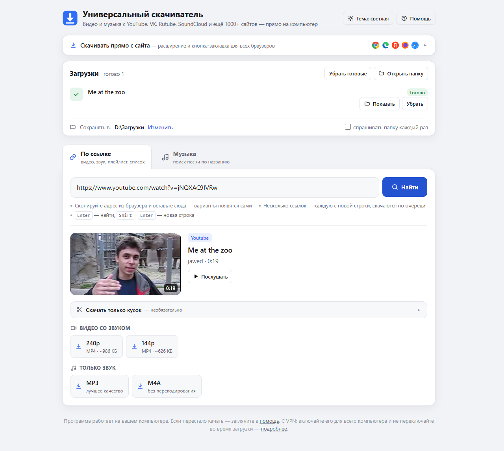
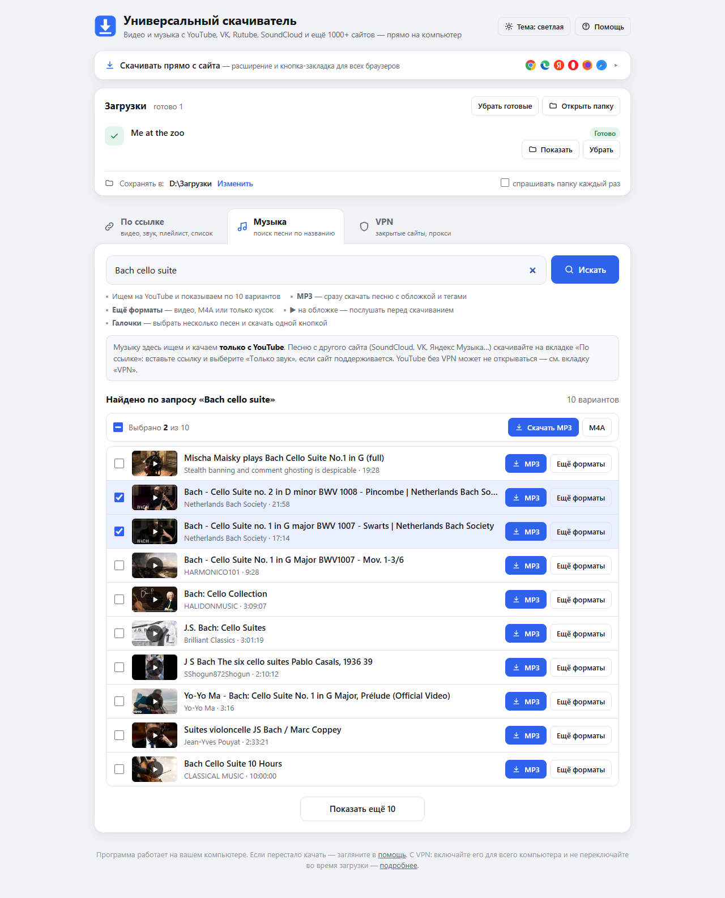
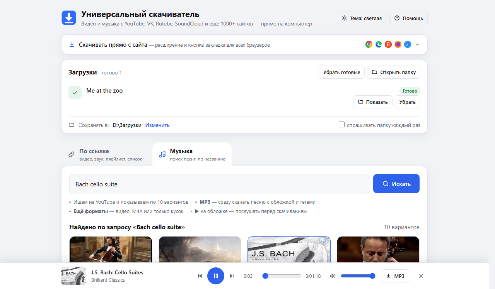
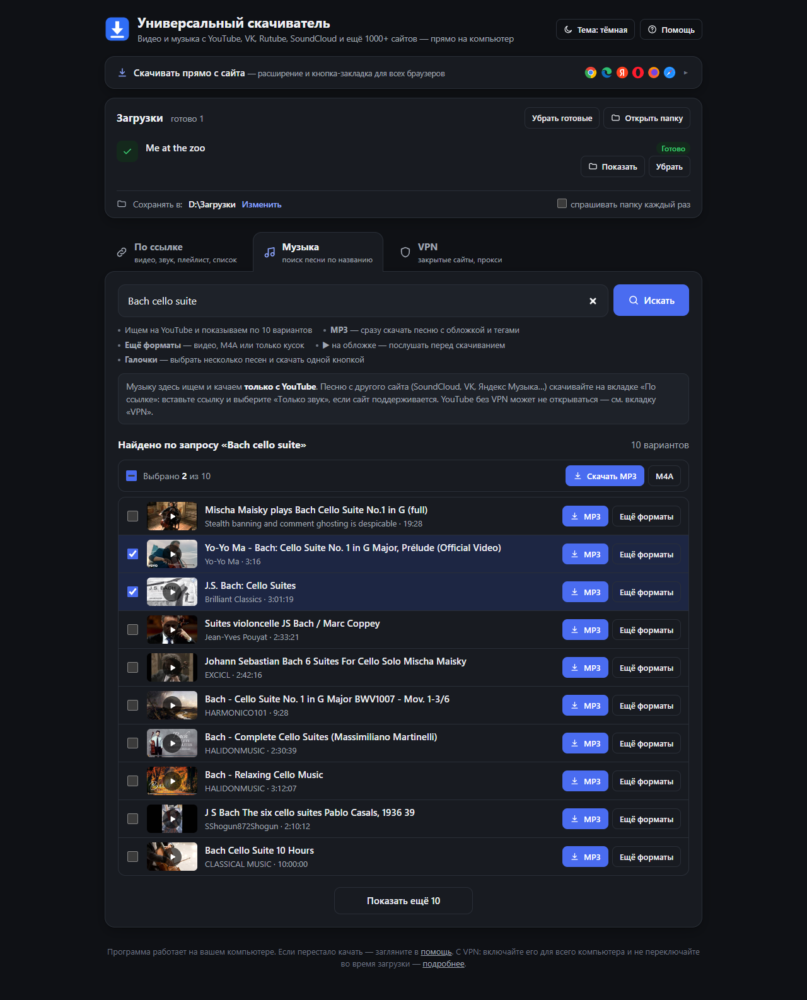
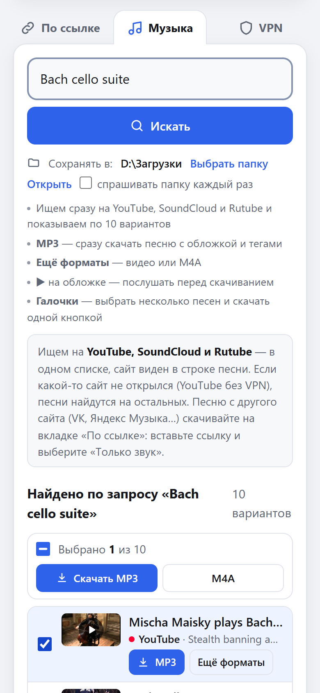
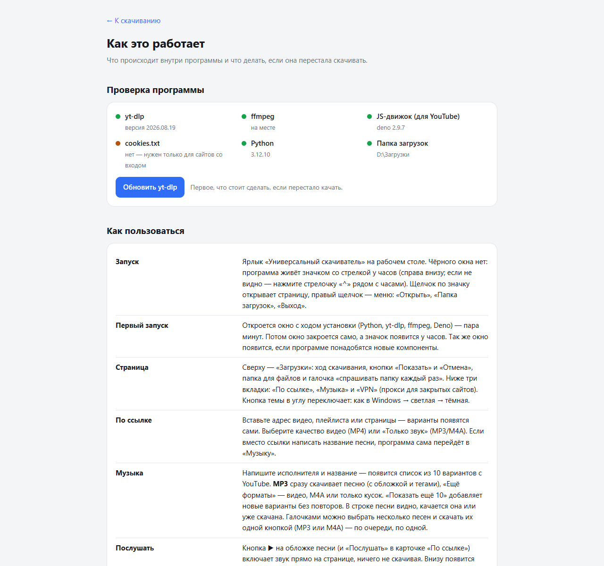

# Универсальный скачиватель

Программа для Windows, которая скачивает видео и музыку с YouTube, VK, Rutube, Одноклассников, Дзена, SoundCloud, TikTok и ещё 1000+ сайтов.
Вставляете ссылку или название песни, выбираете качество и получаете файл MP4, MP3 или M4A на своём компьютере.

Всё работает у вас на компьютере: без рекламы, без регистрации и без чужих серверов. Python ставить не нужно, программа установит всё нужное сама.



**[⬇ Скачать последнюю версию](../../releases/latest)**: файл `universal-downloader.zip` в разделе Assets.

---

## Возможности

- **Видео по ссылке**: MP4 в выбранном качестве, от 144p до 4K. Видео и звук склеиваются сами.
- **Только звук**: MP3 с обложкой и тегами («Исполнитель – Песня» берётся из названия ролика) или M4A без перекодирования.
- **Поиск музыки по названию** (на YouTube): 10 вариантов с обложками и кнопкой «Показать ещё 10». MP3 качается в один щелчок.
- **Послушать перед скачиванием**: плеер внизу страницы с перемоткой, громкостью и переходом к следующей песне. Им можно управлять клавишами и кнопками мультимедиа на клавиатуре.
- **Кусок видео**: скачать только отрезок «с–до», например одну песню из часового концерта.
- **Плейлисты и списки ссылок**: целый плейлист или несколько ссылок (каждая с новой строки) качаются по очереди.
- **Скачать прямо с сайта**: расширение для Chrome, Edge, Яндекс Браузера и Firefox или кнопка-закладка (букмарклет) для любого браузера. Открыли видео, нажали кнопку, и программа сама подхватила ссылку. Если программа не запущена, кнопка расширения запустит её.
- **Встроенные плееры с других сайтов**: если видео на странице в чужом плеере (например, KVS), программа найдёт его сама.
- **VPN-программа с прокси** (v2rayN, Hiddify, NekoBox, Clash, Happ…): если сайт не открывается напрямую, программа сама найдёт прокси и пойдёт через него.
- **Значок у часов**: программа работает в фоне без лишних окон. Меню значка: «Открыть», «Папка загрузок», «Выход». Повторный запуск не плодит вкладки: если страница уже открыта, она мигает заголовком.
- **Своя папка загрузок**, светлая и тёмная тема, понятные объяснения ошибок на русском.
- **Сама обновляет yt-dlp** раз в сутки: сайты часто меняют защиту, и свежий yt-dlp это исправляет.

| Музыка: поиск по названию | Прослушивание перед скачиванием |
|---|---|
|  |  |

| Тёмная тема | На узком экране |
|---|---|
|  |  |

---

## Установка

**Нужно:** Windows 10 или 11 (64-бит), интернет при первом запуске и около 350 МБ на диске.

1. Скачайте `universal-downloader.zip` со страницы **[Releases](../../releases/latest)**.
2. Распакуйте архив в любую удобную папку, например в «Документы». Не запускайте программу прямо из архива.
3. Откройте папку и дважды щёлкните **`Запуск.bat`**.
4. Откроется окно установки. Программа сама скачает в свою папку:
   - **Python 3.12** с python.org: встроенная версия, в систему он не ставится;
   - **yt-dlp**: он умеет скачивать с сайтов;
   - **ffmpeg**: склеивает видео со звуком и делает MP3;
   - **Deno**: без него YouTube отдаёт не все качества.

   На это уйдёт пара минут.
5. Когда всё готово, окно закроется само. На рабочем столе появится ярлык **«Универсальный скачиватель»**, у часов появится значок, а в браузере откроется страница программы.

Дальше запускайте программу ярлыком: она стартует сразу, без окна.

> Если Windows спросит «Запустить этот файл?», нажмите «Запустить». Это бывает с файлами из интернета.
> Если антивирус блокирует `ffmpeg.exe` или скрипт установки, добавьте папку программы в исключения.

### Безопасность установки

`start.ps1` проверяет всё, что скачивает:
- у архива Python и у pip сверяется SHA-256 со значениями, зашитыми в скрипт (они сверены с python.org и PyPI);
- у `python.exe` и `python312.dll` проверяется цифровая подпись **Python Software Foundation**.

Если хоть что-то не совпало, файл не используется. Python собирается во временной папке `python.new` и переименовывается только целиком, поэтому недоделанной установки не бывает.

---

## Как пользоваться

### По ссылке
1. Скопируйте адрес видео из браузера и вставьте его на вкладке **«По ссылке»**. Варианты появятся сами.
2. Выберите качество видео или **MP3 / M4A**. Загрузка появится вверху, в блоке «Загрузки».
3. Готовый файл можно открыть кнопкой **«Показать»**.

Несколько ссылок качаются по очереди: вставьте их каждую с новой строки (новая строка — <kbd>Shift</kbd>+<kbd>Enter</kbd>).
Ссылка на плейлист предложит скачать его целиком.

**Кусок видео:** раскройте «Скачать только кусок» и укажите начало и конец (`1:30`, `1:02:15`).

### Музыка
На вкладке **«Музыка»** напишите исполнителя или название песни. Поиск идёт только по YouTube; песню с другого сайта скачивайте по ссылке (вариант «Только звук»). Что можно делать с результатами:
- **MP3**: сразу скачать песню с обложкой и тегами;
- **Ещё форматы**: видео, M4A или только кусок;
- **▶ на обложке**: послушать перед скачиванием.

Клавиши плеера: <kbd>Пробел</kbd> — пауза, <kbd>←</kbd> / <kbd>→</kbd> — перемотка.

### Скачать прямо с сайта
Раскройте плашку **«Скачивать прямо с сайта»** вверху страницы. Там два способа:
- **Расширение** для Chrome, Edge, Яндекс Браузера и Firefox. Добавляет кнопку на панель браузера и пункт «Скачать в программе» в меню правой кнопки мыши.
  - Chromium-браузеры: скачайте архив расширения со страницы, распакуйте, откройте `chrome://extensions`, включите «Режим разработчика», затем «Загрузить распакованное расширение».
  - Firefox: `about:debugging` → «Этот Firefox» → «Загрузить временное дополнение». Обычный Firefox держит его только до перезапуска.
- **Кнопка-закладка (букмарклет)** работает в любом браузере, включая Safari. Перетащите её на панель закладок и нажимайте на странице с видео.

Подробная инструкция с картинками есть на странице **«Помощь»** в самой программе.

### Сайты со входом в аккаунт
Если сайт пишет, что нужно войти (закрытые видео, 18+, «подтвердите, что вы не робот»), положите в папку программы файл **`cookies.txt`**.
Его можно выгрузить из браузера, где вы вошли на сайт: в Chrome или Edge расширением **Get cookies.txt LOCALLY**, в Firefox — **cookies.txt**. Как это сделать, подробно описано на странице «Помощь».
Никому не передавайте `cookies.txt`: в нём ваши входы на сайты.

---

## Если что-то не качается

- В программе есть страница **«Помощь»** с разбором частых ошибок. Под каждой ошибкой есть кнопка **«Подробнее»** с исходным текстом.
- **Обновите yt-dlp**: кнопка на странице «Помощь» или запуск `Запуск.bat`. Программа и так обновляет его раз в сутки.
- **VPN** включайте для всего компьютера и не переключайте во время загрузки: ссылки на видео привязаны к адресу, и при смене VPN появится ошибка 403. VPN-расширение в браузере на программу не действует. Если у VPN-программы есть прокси, его можно найти или вписать в «Загрузки» → «VPN и прокси».
- Значок не появляется: запустите `Запуск.bat`, он покажет в окне, что не так. Ошибки самой программы пишутся в `program.log`.
- Чтобы переустановить всё начисто, закройте программу (значок → «Выход»), удалите папки `python` и `bin` и запустите `Запуск.bat`.



Некоторые сайты (например, Suno) yt-dlp не поддерживает намеренно, по юридическим причинам. Программа об этом скажет.

---

## Как это устроено

Программа — небольшой веб-сервер на **Flask**, который слушает только `127.0.0.1:8765`. Интерфейс — обычная страница в вашем браузере.
Скачивание делает **[yt-dlp](https://github.com/yt-dlp/yt-dlp)**, видео со звуком склеивает **ffmpeg** (из пакета `imageio-ffmpeg`), YouTube расшифровывает **Deno**. Значок у часов рисует **pystray**.

Сервер принимает запросы только со своей страницы. Он проверяет `Host`, `Origin` и `Sec-Fetch-Site` и принимает только JSON в POST-запросах, поэтому чужие сайты не могут им управлять.
Для сайтов, с которыми встроенные разборщики yt-dlp не справляются (ЯП файлы, yaplakal.com, Одноклассники), в `sites.py` есть свои.

### Файлы

| Файл / папка | Что это |
|---|---|
| `Запуск.bat` | Запуск с окном: ставит и обновляет компоненты, создаёт ярлык, запускает программу |
| `start.ps1` | Вся логика установки (встроенный Python, pip, пакеты, ярлык) |
| `launch.vbs` | Запуск с ярлыка без окна. Если что-то не установлено, вызывает `start.ps1` |
| `app.py` | Сервер и вся логика скачивания |
| `sites.py` | Свои разборщики сайтов для yt-dlp |
| `web/` | Страницы программы: главная и «Помощь» |
| `extension/` | Расширение для браузеров (Manifest V3, Chromium и Firefox) |
| `requirements.txt` | Пакеты Python: yt-dlp, flask, imageio-ffmpeg, deno, pystray, pillow |
| `build-zip.ps1` | Сборка архива для раздачи |

Появляются при работе (в git не входят):

| | |
|---|---|
| `python/` | Свой Python программы с пакетами. Можно удалить, при запуске поставится заново |
| `bin/` | `ffmpeg.exe` |
| `Скачанное/` | Папка загрузок по умолчанию |
| `settings.json` | Настройки: папка загрузок, «спрашивать каждый раз», порт |
| `cookies.txt` | По желанию, для сайтов со входом |
| `program.log` | Журнал работы в фоне |

### Настройки
- **Порт**: если 8765 занят другой программой, поменяйте `"port"` в `settings.json` и перезапустите. После этого заново перетащите кнопку-закладку и переустановите расширение.
  Переменная окружения `DOWNLOADER_PORT` важнее настройки.
- Ручные команды (PowerShell в папке программы):
  ```powershell
  python\python.exe -m pip install -U "yt-dlp[default]"   # обновить yt-dlp
  python\python.exe -m yt_dlp -F "ссылка"                 # что yt-dlp видит по ссылке
  ```

---

## Для разработчиков

Запуск из исходников: клонируйте репозиторий и запустите `Запуск.bat`. Он поставит встроенный Python в `python\` так же, как у пользователей.

Тестовый сервер на другом порту, чтобы не мешать основной копии:
```powershell
$env:DOWNLOADER_PORT = '8799'; python\python.exe app.py --no-browser
```

Сборка архива для раздачи (`dist\Универсальный скачиватель.zip`):
```powershell
powershell -NoProfile -ExecutionPolicy Bypass -File build-zip.ps1
```
В архив попадают только файлы программы. Личные файлы (`settings.json`, `cookies.txt`, `program.log`, `Скачанное`), `python`, `bin` и файлы разработки в него не попадают.

`start.ps1` и `build-zip.ps1` должны быть в UTF-8 **с BOM**, а `Запуск.bat` и `launch.vbs` — только ASCII. Иначе Windows PowerShell 5.1 и cmd портят русский текст.

---

## Правовая сторона

Программа — оболочка над yt-dlp для личного использования. Скачивайте только то, на что у вас есть права, и соблюдайте правила сайтов и законы своей страны.
